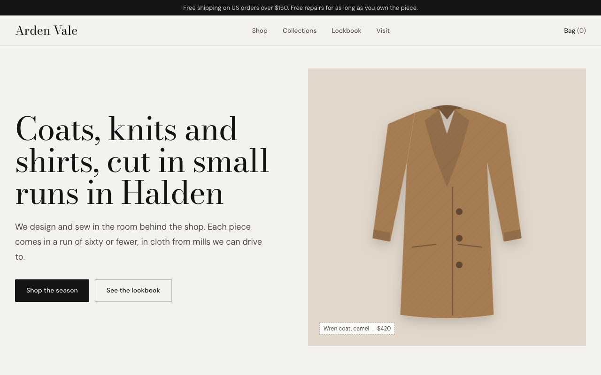

# Arden Vale: Next.js clothing store template

A static Next.js clothing store for a small fashion boutique, with collections, size and color filters, a size guide, a bag and a lookbook. Checkout goes through hosted payment links, so it needs no server.



[](https://console.cloudzyro.com/new?repo=https://github.com/Cloudzyro/template-clothing-store)

## What's included

- Home page with a featured piece, the collections, new arrivals, a lookbook look and the shop's story
- Shop page with filters for collection, size and color, and sorting by newest or price (links like `/shop/?collection=knitwear&size=M` land filtered)
- A page for every collection and every product, generated from one data file
- Product pages with colorways, front, back and close-up views, sizes, a size guide in an accessible dialog, fit notes, cloth and care
- A bag saved in the browser's localStorage, in a slide-over drawer (Escape closes it, focus stays inside while it's open)
- Checkout through hosted payment links (Stripe Payment Links, Paddle, Lemon Squeezy or similar), set per product and optionally per color or size
- Lookbook page with five looks, each piece linked to the shop
- Visit page with address, hours, FAQ and a contact form that posts to a form service of your choice
- Product structured data, Open Graph tags, sitemap, robots.txt and favicon
- Responsive down to 360px, visible focus styles, reduced motion respected
- Garments are flat SVG drawings made in code, so there are no photos to license

## Run it locally

```bash
pnpm install
pnpm dev        # http://localhost:3000
pnpm build      # static site in out/
```

## Make it yours

- **Products and collections:** `data/products.ts` holds the collections and every product (name, garment drawing, price, colorways, sizes, fit note, details, cloth, care, payment link). Pages, filters and the sitemap update by themselves.
- **Store details:** `data/site.ts` holds the store name, address, hours, menu, announcement bar, home page text, size charts, lookbook looks and FAQ.
- **Payments:** create a payment link for each product in Stripe (Payment Links), Paddle or Lemon Squeezy and put it in `paymentLink`. For a different link per option, add `variantLinks` keyed like `"Camel"`, `"M"` or `"Camel / M"`.
  - When the bag holds one product, Check out goes to that product's link.
  - When it holds products with different links, the bag goes to `storeCheckoutUrl` in `data/site.ts` if you set one, and otherwise shows Pay for this next to each item.
  - The placeholder links are examples and won't open a real checkout until you replace them.
- **Contact form:** set `NEXT_PUBLIC_FORM_ENDPOINT` to a form endpoint from Formspree, Basin, a Supabase function or similar. The form sends `name`, `email`, `topic`, `order` and `message` as form data. With no endpoint set, the form shows a short note and opens the visitor's email app addressed to the email in `data/site.ts`.
- **Site address:** set `NEXT_PUBLIC_SITE_URL` (for example `https://shop.example.com`) so the sitemap and social previews use your domain.
- **Colors and fonts:** colors are CSS variables at the top of `app/globals.css`. Fonts are Bodoni Moda (headlines) and DM Sans (everything else), self-hosted through Fontsource and imported in `app/layout.tsx`.
- **Product images:** `components/GarmentArt.tsx` draws each garment type in its colorway. To use photos instead, swap it for an `` with your own files in `public/`.
- **Social preview image:** replace `public/og.png` (1200 x 630).

Environment variables are read at build time. Locally, put them in `.env.local`:

```bash
NEXT_PUBLIC_FORM_ENDPOINT=https://formspree.io/f/your-id
NEXT_PUBLIC_SITE_URL=https://shop.example.com
```

## Deploy

Click the Deploy button above, or push your own copy to GitHub and connect it in the Cloudzyro console. Add the environment variables in your site's settings. The build command is `pnpm build` and the output folder is `out/`, a plain static site.

## Stack

- Next.js 16 with static export (`output: "export"`)
- React 19
- Tailwind CSS 4
- TypeScript
- Fontsource (Bodoni Moda, DM Sans)

MIT licensed. See [LICENSE](./LICENSE).
